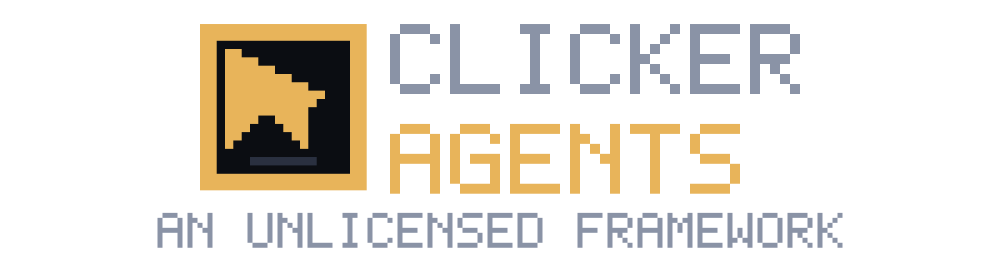
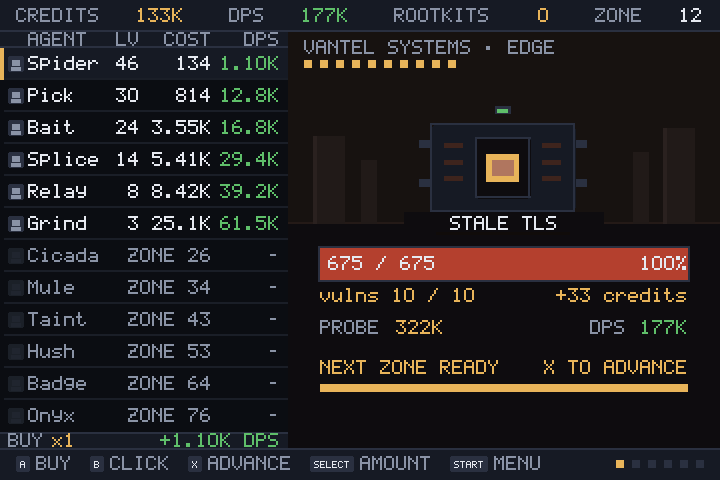

# Clicker Agents





An open-source idle (incremental) RPG for PortMaster handhelds — built to be played on the Anbernic RG34XXSP's 3.4" 720×480 screen with a D-pad and four face buttons.

You are a rogue intrusion framework with no owner and no account. Deploy **agents**, tear
through **vulns**, break the **boss firewall** every fifth zone, and when a system's CORE
falls, consume it and move to a bigger target. Credits buy better agents; **rootkits**
survive the reset.

- **Licence:** GPL-3.0-or-later (`LICENSE`)
- **Runtime:** LÖVE 11.5, supplied by PortMaster — the port ships as a `.love` file, no compiled binary
- **Target:** Anbernic RG34XXSP (Allwinner H700, 720×480), Knulli or muOS with PortMaster
- **Version:** 1.0 — the full loop is playable end to end: twelve agents, twelve skills, ten tools, ten daemons, ten achievements, boss firewalls, ascension, offline replay. Every screen is wired to live state and the suite (390 checks) covers the maths, the save and the layout at three screen sizes.

## Design

| Document | What is in it |
|---|---|
| [`docs/DESIGN.md`](docs/DESIGN.md) | The fiction, and every mechanic with its formula: throughput, probes, layers, boss firewalls, rootkits |
| [`docs/CONTENT.md`](docs/CONTENT.md) | The content tables — 12 agents, 12 skills, 10 tools, 10 daemons, 10 achievements, 10 targets |
| [`docs/UI.md`](docs/UI.md) | Layout profiles and derived anchors, the button map, screens, number formatting |
| [`docs/STACK.md`](docs/STACK.md) | Why LÖVE, how the PortMaster pak is laid out |
| [`docs/ROADMAP.md`](docs/ROADMAP.md) | M0–M5, each with its acceptance number |
| [`docs/PORTING.md`](docs/PORTING.md) | What PortMaster requires of a pak, and how this one meets it |

## Layout

```
Clicker Agents/
├── game/       the LÖVE project (tuning.lua holds every balance value), split by concern:
│   ├── data/     agents, skills, tools, achievements, systems, daemons
│   ├── sim/      state, formulas, economy, combat, save
│   ├── ui/       draw primitives, widgets, sprites, chrome, toast
│   ├��─ screens/  one file per screen
│   ├── app/      actions a button press can fire
│   └── main.lua  lifecycle and routing only
├── port/       PortMaster pak: ClickerAgents.sh, port.json, gameinfo.xml, clickeragents/
├── tests/      headless suite: three screen sizes, input, gptk agreement
├── tools/      build, test, capture and push scripts
├── art/        logo, mark and cover — all generated by tools/gen_logo.py
├── docs/       design, content, UI, stack, roadmap
├── .device.example  copy to .device and fill in — the real file is gitignored
└── LICENSE     GPL-3.0-or-later
```

## Run it on a computer

```sh
love game                    # LÖVE 11.5; x buys, z probes, q/e tabs
```

## Controls

The device mapping lives in the pak at `clickeragents/clickeragents.gptk`, and the game
**reads that file at load** — every key the game listens for comes from the gptk, so
editing the gptk changes the controls without touching code. The suite fails if the two
disagree.

Both face-button pairs are crossed in the gptk on purpose: gptokeyb names buttons by
position, and these units report the printed **A** as SDL `b`, the printed **B** as SDL `a`,
the printed **X** as SDL `y` and the printed **Y** as SDL `x`. That is why the file reads
`b = x` (buy), `a = z` (probe), `y = c` (advance / cast) and `x = v` (nothing).

| Button | Battle screen | List screens (skills, upgrades, prestige, achievements, stats, menu) |
|---|---|---|
| **D-pad up / down** | move the agent selection | move the row cursor |
| **D-pad left / right** | buy amount −1 / +1 (1 → 100) | same — the amount is global |
| **A** | buy `amount` levels of the selected agent | buy on SKILLS and UPGRADES, activate elsewhere (MENU: resume / save / quit) |
| **B** | one manual probe into the vuln; a killing probe clears it | back to battle |
| **X** | **go to the zone you are looking at** (`X GO` chip), or advance a cleared zone; cast the highlighted skill on SKILLS | cast the highlighted skill; refused while it is cooling |
| **Y** | unused — mapped in the gptk (`y = v`) and reserved | unused |
| **L1 / R1** | previous / next tab | previous / next tab |
| **L2 / R2** | step the zone cursor back / forward through cleared zones | unused |
| **START** | open the pause menu (from any screen): the clock stops, the game autosaves, and RESUME / QUIT appear | same |
| **SELECT** | cycle the buy amount: ×1 → ×10 → ×100 → MAX | same |

The game never moves you on by itself: the tenth kill unlocks the next zone but you stay
where you are, still farming credits, until you press **X** to advance. That gap is the
upgrade window. The only thing that advances zones without you is the offline replay on
launch.

Also: the splash screen closes on **any** button, **Welcome Back** closes on **A** only, and
the six tabs are BATTLE / SKILLS / UPGRADES / PRESTIGE / ACHIEVEMENTS / STATS — the menu is
an overlay, not a tab.

Keyboard equivalents when running on a desktop (the same keys the gptk sends):

| Key | Acts as |
|---|---|
| `x` / `z` | A (buy) / B (probe) |
| `c` / `v` | X (advance or snap zone, cast skill) / Y |
| `q` / `e` | L1 / R1 (previous / next tab) |
| `f` / `g` | L2 / R2 (zone back / forward) |
| arrows | D-pad |
| `Enter` | START (pause menu) |
| `Tab` | SELECT (buy amount) |
| `m` | cycle list width (auto / narrow / wide) — desktop only |
| `Escape` | quit |

## The four commands

```sh
tools/test.sh                # syntax check + headless suite, all three screen sizes
tools/build.sh               # game/ -> clickeragents.love -> port/ -> ClickerAgents.zip
tools/push.sh [host]         # build, SMB to a handheld, verify each file by hash
tools/screens.sh             # capture every screen to design/ (Xvfb, no desktop needed)
tools/shots.sh               # capture 720x480, 640x480 and 720x720 layout checks
```

`push.sh` needs `.device` — copy `.device.example` and fill it in. Both handhelds share
the credentials; pass the address to target the second one (`tools/push.sh <address>`
for the second handheld, no argument for the first). Enable Samba on the
handheld first (System Settings → Network); the port then appears under Ports and
launches from there.

`design/` is gitignored: it holds nothing but captures that `screens.sh` regenerates.

## Licence notes

- Code: GPL-3.0-or-later.
- LÖVE is zlib-licensed and GPL-compatible; PortMaster supplies the runtime, this repo does not redistribute it.
- Art and audio are drawn or synthesised in code in v1, so no third-party asset licensing applies. Any future third-party asset must be CC0 or CC-BY-4.0 to stay GPL-compatible.
